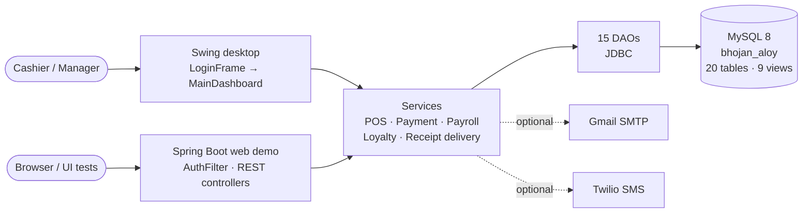
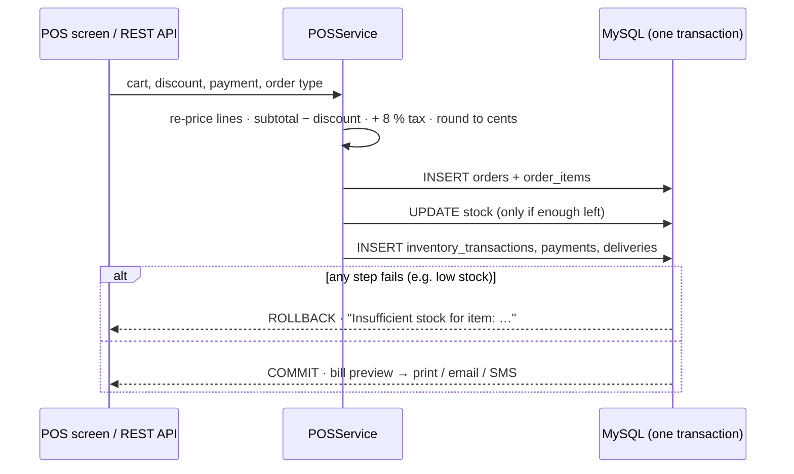

<div align="center">

# ☕ Bhojanaloy — Food & Coffee Shop POS System

### A point-of-sale system for a café: Java Swing desktop till + Spring Boot web demo, on one MySQL database, tested from the pay rules to the live API

[](https://git.io/typing-svg)

<!-- ============ STATUS BAR ============ -->
[](https://github.com/rbchy/BhojanAloy-Food-Coffee-Shop-POS-System/actions/workflows/ci.yml)


</div>

---

## 📌 At a Glance

<table>
<tr>
<td width="50%" valign="top">

**🙋 What this is**

A complete POS for a food and coffee shop. It has two front ends on the same MySQL database:

- **Desktop till (Java Swing):** POS with cart, tax, discounts and payments. It also covers kitchen station display, phone/online orders and delivery dispatch, menu and 5-language recipes, inventory, suppliers, time clock, payroll, a loyalty program, and reports.
- **Web demo (Spring Boot + plain HTML/JS):** login, menu, cart, checkout and order history. Every element has a stable `id`, so it can be used as a target for Selenium / Playwright / WebdriverIO practice.

Every push runs both builds in GitHub Actions on a real **MySQL 8**. The pipeline runs unit, database and API tests. It then starts the desktop app under a virtual display, and starts the web jar and checks it with `curl`.

</td>
<td width="50%" valign="top">

**📍 Quick facts**

| | |
|---|---|
| 🖥️ **Desktop** | Swing, 11 screens, 3 roles |
| 🌐 **Web** | Spring Boot REST + HTML/JS |
| 💾 **Database** | MySQL 8 · 20 tables · 9 views |
| 🧪 **Tests** | 56 unit · 9 MySQL · 11 web API |
| ✅ **CI** | 76 / 76 + launch + smoke · ≈ 1.5 min |
| 🌍 **Languages** | Help and recipes in EN · বাংলা · ES · हिंदी · العربية |
| 🔐 **Secrets** | none in code: env vars / `db.properties` |

</td>
</tr>
</table>

---

## ✅ Latest Results

| Suite | Runs against | Result |
|---|---|---|
| `PayrollServiceTest` | regular / overtime / weekend / holiday pay, stacking, **8 h cap per day**, rounding | ✅ 9 / 9 |
| `OrderTotalsTest` | subtotal, discount before 8 % tax, cents rounding, discount bigger than the bill | ✅ 7 / 7 |
| `LoyaltyProgramTest` | 1 point per order; at 50 points the cheapest item is free and the points reset | ✅ 6 / 6 |
| `BillFormatterTest` | itemized bill text, column width, delivery address, loyalty line | ✅ 4 / 4 |
| `ValidationUtilTest` · `PasswordUtilTest` | email / phone / price checks, salted SHA-256, sample `admin123` | ✅ 27 / 27 |
| `OrderNumberTest` | 50 000 numbers in a burst and 4 tills in parallel, with no repeats | ✅ 3 / 3 |
| `DatabaseIT` (MySQL) | login, checkout with stock + payment + delivery in one transaction, rollback on low stock, recipes in 5 languages, **every DAO read vs the schema** | ✅ 9 / 9 |
| `WebSecurityTest` · `PosApiIT` (MySQL) | 401 without a session, server-side re-pricing, bad carts → 400, out of stock → 409 | ✅ 11 / 11 |
| Launch check · smoke test | the Swing jar is still running after 20 s; the web jar: health → login → menu → checkout | ✅ |

> These tests have found real bugs. On the first CI runs they caught:
> - a **fresh install whose Recipes screen crashed**, because the "full" SQL script was missing four columns;
> - an order-number scheme that **could repeat** and fail a checkout.
>
> Both are fixed (see the Maintenance Log).

---

## 🏗️ Architecture



The web demo reuses the desktop app's data layer: 11 DAO, model and service files are copied word for word. `scripts/check-shared-code.sh` runs in CI and fails if the two copies drift apart.

### 🛒 One checkout, one transaction



---

## ✨ Features

| Screen | What it does |
|---|---|
| 🛒 **Point of Sale** | Category-tabbed menu with item photos (or emoji). Live cart, discount, 8 % tax. Cash / card / mobile banking. In-store / phone / online orders; dine-in / pickup / delivery. |
| 🧾 **Bill preview** | Itemized bill. **Print** it (any OS printer, including a thermal receipt printer), or **send** it by email or SMS. |
| 🧑‍🍳 **Station Display** | Each line goes to its prep station (Coffee Bar, Bakery, …). Status moves PENDING → PREPARING → READY → SERVED; the screen refreshes every 5 s. |
| 🛵 **Delivery** | Delivery orders queue up here. Assign an in-house rider or an agency, then mark **Picked Up** and **Delivered**. |
| 🍽 **Menu Items** · 📖 **Recipes** | Price vs cost and an image per item. Recipes have ingredients, prep time, and steps in **5 languages**. |
| 📦 **Inventory** · 🧺 **Suppliers** | Stock levels, low-stock flags, adjustments with an audit log, supplier directory |
| ⏱ **Time Clock** · 💰 **Payroll** | Clock in and out. Pay is calculated as regular / overtime ×1.5 / weekend ×1.5 / holiday ×2.0, with overtime stacking on top. Pay by direct deposit, cash or check; print a pay stub. |
| ⭐ **Loyalty** | 1 point per order. The 50th point makes the cheapest item free. Customers who give an email get new-item announcements. |
| 📊 **Reports** | Today's summary, 30-day sales, item / category sales, employee performance, low stock. Each can be exported to CSV. |
| ❓ **Help** | Full in-app guide in English, বাংলা, Español, हिंदी and العربية |

**Roles:** CASHIER sees POS, stations, menu, recipes, inventory, delivery and time clock. MANAGER and ADMIN also see Employees, Payroll, Suppliers and Reports; today these two roles have the same access.

**Simulated integrations:**
- The payment gateway and direct deposit are always simulated.
- Email and SMS receipts are real once `BHOJAN_SMTP_*` / `BHOJAN_TWILIO_*` are set; until then they are simulated too.
- The service classes show where a real provider plugs in.

---

## 🛠️ Tech Stack

| Layer | Technology |
|---|---|
| Desktop UI | Java Swing (custom theme, hover effects, `java.awt.print`) |
| Web | Spring Boot 2.7 REST, session login, plain HTML / CSS / JS |
| Data | JDBC, MySQL Connector/J, MySQL 8 (`utf8mb4`) |
| Email / SMS | Plain-JDK SMTPS client, Twilio REST over `java.net.http` (no extra jars) |
| Build | Maven: shaded desktop jar (`target/bhojanaloy-desktop.jar`), Spring Boot jar (`webapp/target/bhojanaloy-webapp.jar`) |
| Tests | JUnit 5, Spring MockMvc, Failsafe for `*IT` against MySQL |
| CI | GitHub Actions: two jobs, MySQL 8 service, Xvfb launch check, `curl` smoke test, jars and reports as artifacts |

---

## 📁 Project Structure

```text
BhojanAloy-Food-Coffee-Shop-POS-System/
├── .github/workflows/ci.yml        # desktop job + webapp job
├── database/
│   ├── bhojan_aloy_database.sql    # full schema + sample data (fresh installs)
│   └── migration_v2…v5_*.sql       # upgrades for an existing database, in order
├── images/                         # login badge; put item photos here
├── lib/                            # MySQL driver jar for running from Eclipse
├── src/com/bhojanaloy/             # desktop app (Eclipse layout)
│   ├── Main.java
│   ├── config/   DBConnection · EmailConfig · SmsConfig
│   ├── model/    19 entities
│   ├── dao/      15 DAOs
│   ├── service/  POS · Payment · Payroll · Loyalty · ReceiptDelivery · Notification
│   ├── util/     PasswordUtil · ValidationUtil · BillFormatter · ReceiptPrinter · SmtpMailSender · …
│   └── gui/      LoginFrame · MainDashboard · POSPanel · PayrollPanel · RecipePanel · HelpDialog · …
├── test/com/bhojanaloy/            # desktop unit tests + DatabaseIT
├── webapp/                         # Spring Boot web demo (own pom, README in Bangla, deploy/ files)
├── scripts/check-shared-code.sh    # desktop ↔ web copies must match
├── db.properties.example           # copy to db.properties (git-ignored)
└── pom.xml                         # desktop build
```

---

## ⚙️ Getting Started

**You need:** JDK 11 or newer, Maven 3.8+, and MySQL 8.

```bash
# 1. Database: schema + sample data (drops and recreates bhojan_aloy)
mysql -uroot -p --default-character-set=utf8mb4 < database/bhojan_aloy_database.sql

# 2. Credentials: environment variables, or copy db.properties.example to db.properties
export DB_USER=root DB_PASSWORD='your-password'
#    (DB_URL defaults to jdbc:mysql://localhost:3306/bhojan_aloy)

# 3a. Desktop till
mvn verify                                  # unit tests; DB tests too when DB_URL is set
java -jar target/bhojanaloy-desktop.jar     # run from the repo folder so images/ is found

# 3b. Web demo, then open http://localhost:8080
cd webapp && mvn verify && java -jar target/bhojanaloy-webapp.jar
```

**From Eclipse:** File → Import → Existing Projects into Workspace, then run `Main.java`. The driver jar is already in `lib/`. Put your MySQL password in `db.properties` in the project folder.

**Sample logins** (password `admin123` for all three; checked in CI):

| User | Role |
|---|---|
| `admin` | ADMIN |
| `farida` | MANAGER |
| `sabbir` | CASHIER |

**Upgrading an older database:** run `migration_v2` → `v3` → `v4` → `v5` in order instead of re-importing. For a fresh install, use the full script.

---

## 🧹 Maintenance Log

The README was checked against the code, and these issues were fixed:

| Issue found | Fix |
|---|---|
| ❌ **No Java source on GitHub.** The repo had only a partial `bin/` of `.class` files (part of the upload was missing) and a pre-built web jar. | Added the full source (desktop `src/` and `webapp/`) from the author's workspace. `bin/` and `target/` are no longer tracked. |
| 🔑 **A real-looking MySQL password and a personal Gmail address** were in the code (`DBConnection`, `EmailConfig`) | Removed. Credentials now come from env vars or a git-ignored `db.properties`. **Change that MySQL password wherever it was used**, because it is still in the Git history. |
| 🗄️ **Fresh install broke the Recipes screen.** The full SQL script lacked the 5-language recipe columns from `migration_v5` (found by CI). | Added the columns and translations to `bhojan_aloy_database.sql`, plus a recipe round-trip test |
| 🔢 **Order numbers could repeat.** The scheme was "date + random 4 digits" on a UNIQUE column, about 50 % odds of a duplicate at around 120 orders a day, and that checkout then failed. | Order numbers are now built from millisecond time plus a sequence, guaranteed unique within the app and tested with 50 000 numbers |
| 💰 **Payroll paid split shifts wrong.** The 8-hour cap was applied per shift, so 6 h + 6 h on one day was paid as 12 regular hours. | The cap is now per day (8 regular + 4 overtime) |
| 🧾 **Totals were not rounded and could go negative.** The stored order kept 4-decimal tax, and a large discount made the total negative, even though the screen preview already clamped it. | Totals are rounded to cents and floored at 0, so the receipt, the payment and the database row always match |
| 🌐 **The web checkout accepted a negative discount** (which raises the bill) and returned raw SQL errors for unknown payment methods | These now return `400` with a clear message |
| 📝 **The README described the wrong logins.** It said the sample logins needed a manual hash step (they already use `admin123`). It also said MANAGER cannot manage employees or suppliers (in the code MANAGER and ADMIN have the same access). | The README was rewritten to match the code |
| 🧪 No tests, no build file for the desktop app, no CI | Added a Maven build, 76 tests, the drift check, a launch check, a smoke test, and GitHub Actions |

---

## 📈 Roadmap

- [ ] Give ADMIN rights MANAGER does not have (user management, price changes)
- [ ] Replace salted SHA-256 with bcrypt / Argon2, and add login throttling to the web demo
- [ ] Move the shared data layer into one Maven module instead of copies
- [ ] Playwright UI tests for the web demo, using its stable element ids
- [ ] Purchase-order screen (the tables already exist)
- [ ] A real payment gateway (SSLCommerz / bKash) behind `PaymentService`

---

## 🔗 Related Projects

| Project | Stack |
|---|---|
| ⭐ [RbcTcsWorld E-Commerce Suite](https://github.com/rbchy/RbcTcsWorld_ECommerceSuite) | Spring Boot · REST Assured · Selenium · Playwright · CI quality gates |
| 💊 [PPES — Pharmaceutical Packaging Management](https://github.com/rbchy/PPES-Pharmaceutical-Packaging-Management) | Java Swing · MySQL · 49 / 49 in CI |
| 🕐 [RbcTcsWorld EPMS](https://github.com/rbchy/RbcTcsWorld-EPMS) | JavaFX employee / time-clock system · MySQL · CI |
| 🧮 [Pharmaceutical Production Management Calculator](https://github.com/rbchy/RbcTcsWorld_Pharmaceuticals_PMC) | Spring Boot · MySQL · 81 / 81 in CI |

<sub>All projects: [github.com/rbchy](https://github.com/rbchy)</sub>

---

## ⚠️ Disclaimer

This is a **portfolio / training project**. Payments and bank transfers are simulated. Do not use it to take real money or hold real customer data without a proper security review.

---

## 👤 Author

<div align="center">

**Ranajit Baran Chowdhury (RB Chowdhury)**
QA Automation Engineer / SDET · West Norriton, Pennsylvania, USA

[](https://www.linkedin.com/in/rbchy/)
[](https://github.com/rbchy)
[](https://rbchy.github.io/rbchy/)
[](https://rbc6543.wixsite.com/rbc-portfolio)
[](mailto:chyranajit@gmail.com)

<sub>MIT licensed — see [LICENSE](LICENSE).</sub>

⭐ *If this project helps you, a star on the repo is appreciated.*

</div>
